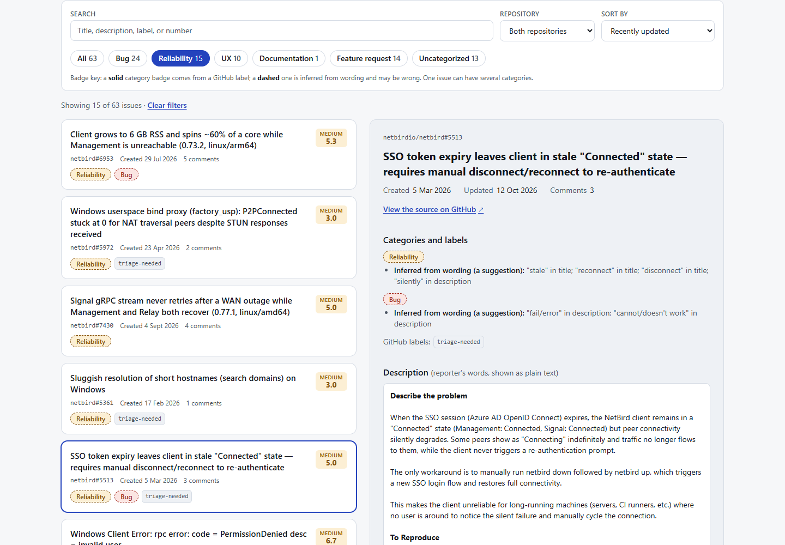
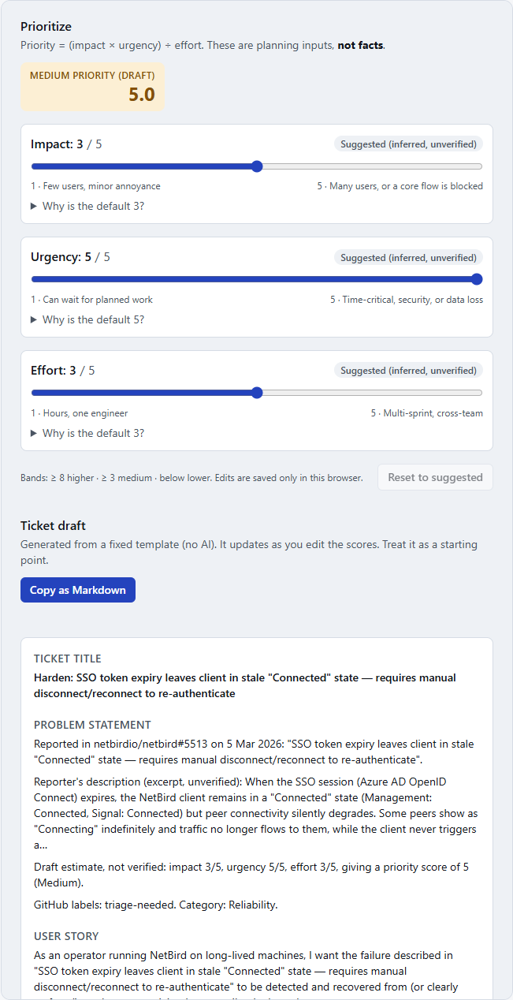
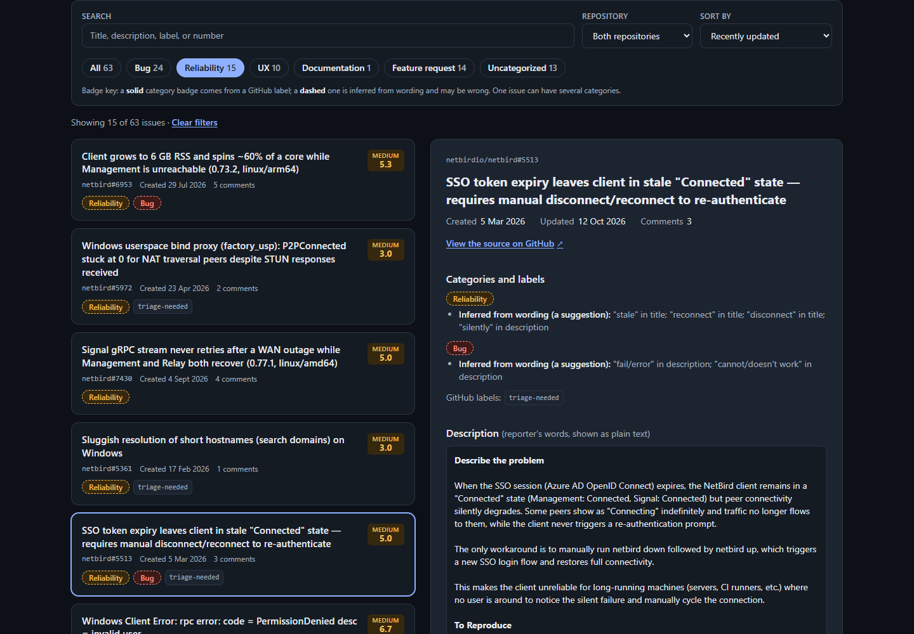
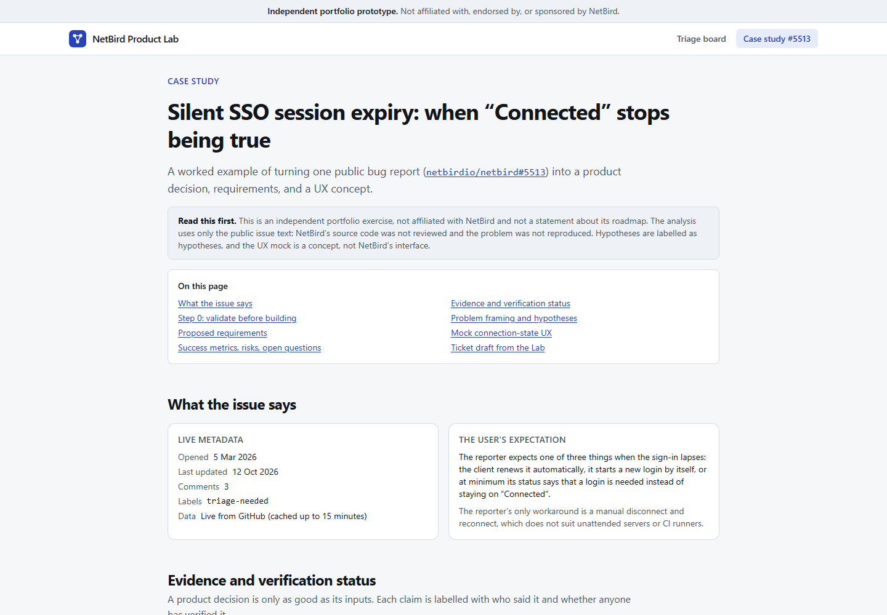
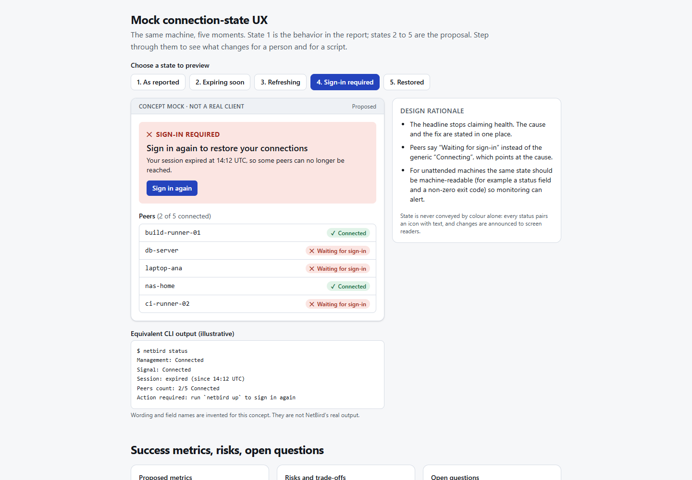
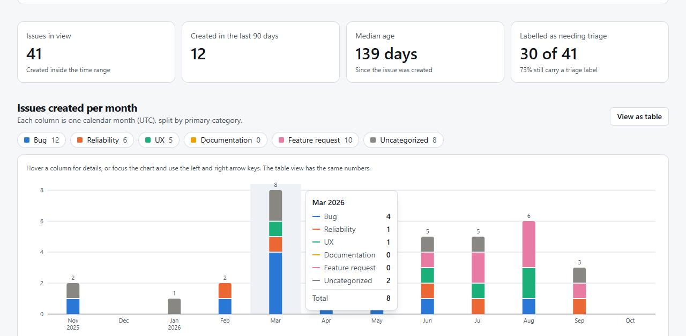
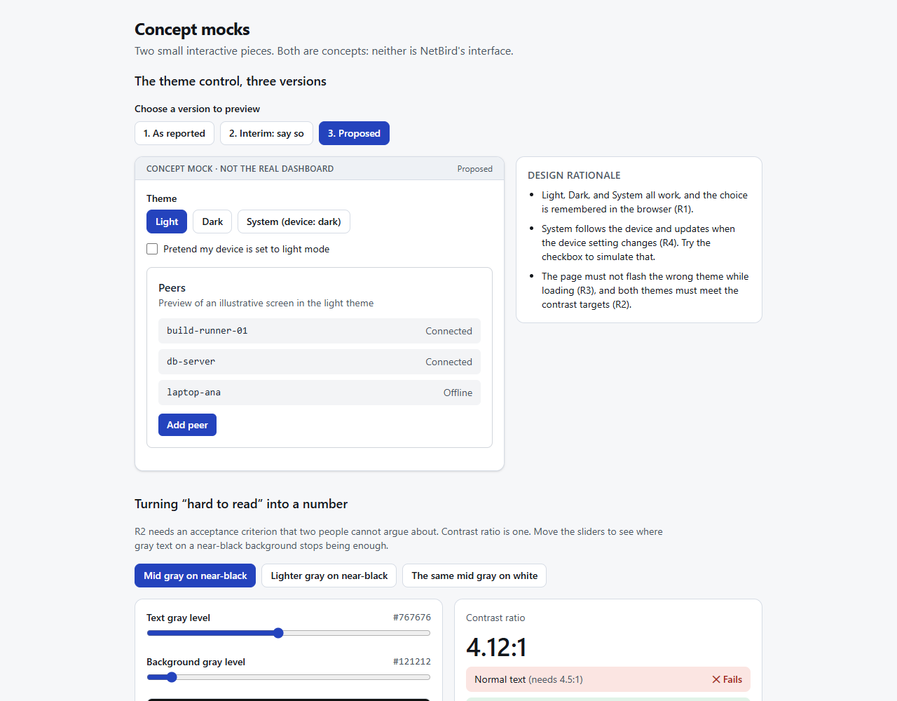
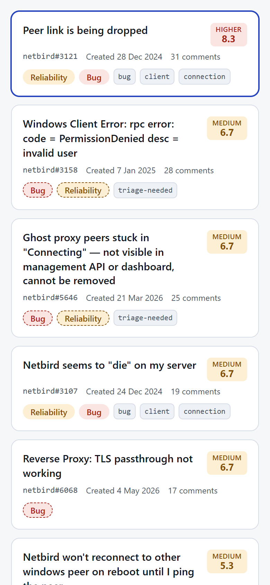
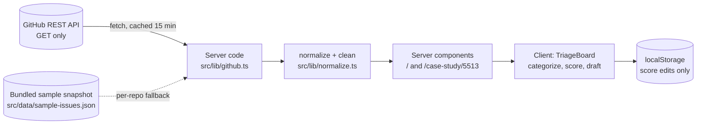

# NetBird Product Lab

[](https://github.com/sreos/netbird-product-lab/actions/workflows/ci.yml)

**Live demo: <https://netbird-product-lab.vercel.app>**

**Turn open-source feedback into backlog-ready tickets.** A portfolio prototype that shows how a Technical Product Owner can triage public GitHub issues, prioritize them transparently, and draft actionable tickets.

> **Disclaimer.** This is an **independent portfolio prototype**. It is **not affiliated with, endorsed by, or sponsored by NetBird** or its maintainers. "NetBird" appears only to identify the public open-source repositories whose issues are analysed (`netbirdio/netbird`, `netbirdio/dashboard`). No NetBird logo or branding is used. Issue text belongs to its original authors. Categories, scores, hypotheses, and drafts here are this prototype's own inferences, may be wrong, and say nothing about NetBird's roadmap. Always read the source issue.



## Contents

- [The problem](#the-problem)
- [Goals and non-goals](#goals-and-non-goals)
- [What it does](#what-it-does)
- [Screenshots](#screenshots)
- [How the model works](#how-the-model-works) (categorization and prioritization)
- [Architecture](#architecture)
- [Getting started](#getting-started)
- [Deploying to Vercel](#deploying-to-vercel)
- [Tradeoffs](#tradeoffs)
- [Limitations](#limitations)
- [Roadmap](#roadmap)
- [Project structure](#project-structure)

## The problem

Open-source projects receive a steady stream of issues that mix bugs, reliability reports, UX friction, documentation gaps, and feature requests. Maintainers and product owners have to answer the same questions again and again: *What kind of problem is this? How much does it matter? Is it even still true? What would a ticket for it look like?*

Doing that by hand is slow, and doing it with opaque tooling is risky, because a confident-looking score or summary that is really a guess can steer real roadmap decisions. This project explores a middle path: **fast triage that is explicit about what is known, what is inferred, and what is unverified.**

## Goals and non-goals

**Goals**

- Read public issues from two repositories using GitHub's REST API, safely and cheaply (caching, fallback, rate-limit awareness).
- Categorize issues into bugs, reliability, UX, documentation, and feature requests, **showing the evidence** behind each label.
- Offer an **editable** impact / urgency / effort model where every default has a stated reason and is never presented as a fact.
- Draft a ticket (problem statement, user story, acceptance criteria, QA scenarios) from deterministic templates.
- Demonstrate product thinking on two real reports of different shapes: [a bug report (#5513)](src/app/case-study/5513/page.tsx) and [a long-running feature request (dashboard #412)](src/app/case-study/dashboard-412/page.tsx).
- Be accessible, responsive, tested, and deployable to Vercel with **no secrets required**.

**Non-goals**

- Writing to GitHub or to any NetBird system. Every external call is a `GET`.
- Replacing human judgment, or claiming a problem is reproduced or fixed.
- Being a full backlog manager (no accounts, no database, no sync).
- Being a statement about NetBird's product direction.

## What it does

| Area | What you get |
| --- | --- |
| **Data** | Open issues from `netbirdio/netbird` and `netbirdio/dashboard` via the GitHub REST API. Title, source link, labels, created date, comment count, and description. Pull requests are filtered out. |
| **Resilience** | Server-side fetch cached for 15 minutes. If GitHub is rate-limited, slow, or down, **each repository independently falls back** to a bundled snapshot of real issues, and a banner says which repo and why. |
| **Filtering** | Free-text search, repository filter, five category filters plus "Uncategorized", four sort orders, live counts, and a clear-filters action. |
| **Related issues and themes** | Finds issues that use the same distinctive wording and groups them into "possible themes" you can filter by. Each link shows **the shared words behind it**, and the interface states that this is wording overlap, not meaning, and never calls anything a confirmed duplicate. See [how it works](#related-issues-and-themes-srclibsimilarityts). |
| **Discussion on demand** | "Load the discussion" fetches an issue's comments (the oldest 50) through a small read-only server endpoint, shows whether **the project team has responded** (owner, member, or collaborator, according to GitHub), and links every comment to the original. Never loaded automatically, to protect the rate limit. Commenter usernames are deliberately not shown or stored. |
| **Backlog trends** | A `/trends` page: issues created per month as a stacked column chart split by category, four figures (issues in view, created in the last 90 days, median age, labelled as needing triage), and a per-category table. One filter row (time range, repository) scopes everything. Built to be read honestly: the data limits are stated above the chart, the current month is marked "in progress", and every chart value is reachable through a table view and from the keyboard. See [how it was built](#backlog-trends-srcapptrends-srclibtrendsts-trendsview). |
| **Shareable views** | Filters, sort, and the selected issue live in the URL, so `/?cat=reliability&issue=netbird-5513` opens that exact view. "Copy link to this view" builds it for you. Edited scores are deliberately **not** in links (they stay in each person's browser); share a prioritized ticket by copying its Markdown. |
| **Categorization** | Label-based (solid badge) or wording-based (dashed badge, "inferred"). An issue can have several categories. The reasons are shown in the detail panel. |
| **Prioritization** | `priority = (impact × urgency) ÷ effort`, each 1 to 5. Defaults are labelled "Suggested (inferred, unverified)" with a "Why is the default N?" explanation. Edit with sliders; edits are marked "Edited by you", saved in your browser only, and resettable. |
| **Ticket drafting** | Problem statement, user story, acceptance criteria, QA test scenarios, and assumptions, from deterministic templates. **Edit any section**: sections you leave alone keep following your scores, edited ones are marked "Edited by you" and can be reset one by one or regenerated all at once. Edits are saved in your browser. Copy as Markdown. No AI involved. |
| **Case studies** | Two worked analyses of real public issues, chosen to differ. [`netbird#5513`](https://github.com/netbirdio/netbird/issues/5513) (a bug whose existence is in doubt): evidence ledger, validate-first plan, hypotheses, requirements R1 to R8, and a connection-state mock. [`dashboard#412`](https://github.com/netbirdio/dashboard/issues/412) (a feature request open for 25 months): a timeline verified against GitHub data, demand versus decision, options with a recommendation, requirements R1 to R8, a theme-control mock, and a WCAG contrast explorer. See [how they are written](#case-studies-srcappcase-study). |
| **States** | Loading skeleton, error boundary, "no issues" and "no matches" empty states, sample-data banner, and not-found page. |

## Screenshots

Captured from a production build with live GitHub data on 12 Oct 2026.

| | |
| --- | --- |
|  **Prioritize and draft.** Every default is labelled as a suggestion and explained. |  **Dark theme** follows the OS setting. |
|  **Case study** of issue #5513. |  **Mock connection-state UX** (a concept, not a real client). |



*Backlog trends, with the tooltip open on March 2026.*



*Case study 2 (dashboard #412): the proposed theme control, and the contrast explorer that turns "hard to read" into a number.*

<p align="center"><br><em>Responsive layout at 390px wide.</em></p>

## How the model works

### Categorization ([`src/lib/categorize.ts`](src/lib/categorize.ts))

Two kinds of evidence, kept separate in the UI:

1. **GitHub labels** (a fact about the issue). Label vocabulary is taken from the two repositories, matched case-insensitively. For example `bug` maps to Bug, `connection` and `performance` to Reliability, `UX` and `client-ui` to UX, `documentation` and `missing-docs` to Documentation, `enhancement` and `feature-request` to Feature request.
2. **Wording** (an inference). Keyword patterns over the title (weight 2) and the first 1,500 characters of the description (weight 1). A category is only suggested when the combined weight reaches 2, so a single stray word does not trigger it.

Example: issue #5513 has only a `triage-needed` label, so its categories come purely from wording and are drawn with dashed badges. The detail panel lists exactly which words matched.

### Prioritization ([`src/lib/scoring.ts`](src/lib/scoring.ts))

`priority = (impact × urgency) ÷ effort`, rounded to one decimal. Bands: **≥ 8 higher**, **≥ 3 medium**, below that **lower**.

| Input | Starts at | Adjustments (each stated in the UI) |
| --- | --- | --- |
| **Impact** | 2 | +1 if categorized as bug or reliability; +1 for 5 or more comments; +1 more for 15 or more |
| **Urgency** | 2 | +1 for severe wording (security, crash, outage, silent failure, cannot log in); +1 for a bug/reliability report with 3 or more comments; +1 if updated in the last 30 days |
| **Effort** | 3, fixed | **Never inferred.** Effort needs an engineering estimate, and the UI says so. |

Comment counts are an *engagement proxy*, not measured user impact. The model is deliberately small enough to read in one sitting, so a reviewer can disagree with it.

### Related issues and themes ([`src/lib/similarity.ts`](src/lib/similarity.ts))

Deterministic and dependency-free, in five steps:

1. **Tokenize** title and description (the first 1,500 characters): lower-case, drop code blocks, URLs, numbers, stop words and issue-template boilerplate, then apply a light stemmer so "reconnecting" and "reconnected" match. Title words count three times as much as description words.
2. **Weigh** words with TF-IDF, so common words matter little and distinctive ones matter a lot. Words that appear in more than half of the issues are ignored.
3. **Compare** issues with cosine similarity.
4. **Gate** the result. A raw similarity score is not trusted, because boilerplate in descriptions produces confident-looking nonsense. Two issues are only linked if they share a word that appears in **both titles**, and either that word is rare or they share at least two distinctive words in total.
5. **Cluster** linked issues into themes with average-link clustering, capped at 8 issues per theme. A theme is labelled with the words most of its members share.

**How the thresholds were chosen, and what that does and does not prove.** I ranked all issue pairs from the 62 live issues available on 12 Oct 2026 and read them, adjusting stop words and the title rule where the top results were clearly wrong (for example links created by "help / file / screenshots / attach" from the bug template, or by "docker" alone). In that informal review most of the 11 resulting themes looked sensible (for instance RPC errors, reverse-proxy reports, and two latency reports) and a few were weak (for instance "firewall · software · check"). This is a hand review, **not a benchmark**: there is no labelled ground truth, and precision and recall are unmeasured. The unit tests pin the behaviour of each rule, and were checked by deliberately breaking each rule to confirm that a test fails.

### Backlog trends ([`src/app/trends`](src/app/trends/page.tsx), [`src/lib/trends.ts`](src/lib/trends.ts), [`TrendsView`](src/components/TrendsView.tsx))

- **Form.** The job is "how the mix of categories changes over time", so a stacked column chart. Marks follow a fixed spec: columns at most 24px wide, a 2px gap of background between segments (no outlines), a 4px rounded end on the top segment only, hairline solid gridlines, and one number per column (the total) instead of a label on every segment.
- **Color.** The five category series use the first five slots of a categorical palette, in a fixed order, and "Uncategorized" is grey. The palette was run through a colorblind-separation validator against this app's own surfaces (white and the dark card color) in both themes: all checks pass, with a worst adjacent colorblind difference of 9.1 (light) and 8.4 (dark) on a scale where 8 is the target. In light mode three colors (green, yellow, pink) fall below 3:1 contrast with white, which the method answers with required visible labels and a table view, so the chart has column totals, a legend with counts, tooltips, and a table twin. Hiding a series from the legend never repaints the others. The chart colors are deliberately separate from the category badge colors elsewhere in the app.
- **Honesty.** Only the most recently *updated* open items are loaded, so the page states that old issues appear only if they are still active, that this is today's backlog and not a history, and that a quiet month does not mean fewer reports. The current month is marked "in progress", and issues older than the chosen range are counted rather than silently dropped.
- **Accessibility.** The chart is a keyboard-focusable group (arrow keys, Home, End) that announces each month, there is a table view with the same numbers, and in forced-colors mode the table replaces the chart. Scrollable tables are focusable.
- **Verification.** I compared the monthly totals shown by the app against an independent count made straight from the GitHub API with no app code involved. All 12 months matched.

### Case studies ([`src/app/case-study`](src/app/case-study/page.tsx))

- **A labelled evidence ledger.** Every claim says who made it (the reporter, other commenters, a maintainer, or GitHub's own data) and whether it is verified. Unknowns are shown, not hidden: for example, whether the dark theme actually fails contrast was never measured, and the case study says so.
- **Facts are separated from interpretation.** In case study 2 the timeline marks each item "Verified" (from GitHub metadata that was fetched and cross-checked) or "Stated in a comment". The conclusion that the bottleneck was prioritization rather than demand is explicitly a hypothesis, with other explanations listed.
- **Step 0 is always "validate before building".** Case study 1 starts from a maintainer's request to retest; case study 2 starts from "measure the contrast first, and ask what blocks the open pull request".
- **The tool's blind spots are part of the study.** Case study 2 shows what the triage board scored, then lists what an automatic score cannot see (reactions, pull requests, the team's silence, the accessibility angle).
- **A finding that changed the product.** Reading the thread showed that GitHub's author association understates team involvement (staff with private membership appear as "contributor"), so the discussion panel now says so.
- **Independence.** Neither study reviews NetBird's code, shows commenter usernames, or speaks for NetBird. Both say so at the top.

### Ticket templates ([`src/lib/ticket.ts`](src/lib/ticket.ts))

Each category has its own user-story persona, acceptance criteria (Given/When/Then where it helps), and QA scenarios. Every draft starts with a "confirm the report still reproduces" scenario and ends with assumptions that state, in plain words, that the problem has not been reproduced by this tool.

## Architecture



- **Server-side data access.** GitHub is called only from server code (`src/lib/github.ts` imports `server-only`). The browser never talks to GitHub, so there is no CORS concern and the optional token can never leak.
- **Static with revalidation.** Both pages are statically generated and revalidated every 15 minutes (`revalidate = 900`). With two repositories plus the case study, that is roughly a dozen GitHub requests per hour regardless of how many people visit.
- **One normalizer for live and sample data.** The sample snapshot is stored in GitHub's own payload shape and runs through the same `normalizeIssue` path, so the fallback exercises the production code.
- **One small dynamic endpoint.** `GET /api/comments?issue=netbird-5513` runs on the server, makes one `GET` to GitHub, and returns comments reduced to role, date, link, and cleaned text. It only serves issues that are in the loaded data (so it cannot be used to enumerate arbitrary issue numbers and burn the shared rate limit), validates its input, caches successes for 15 minutes at the edge, and never caches errors.
- **Untrusted text stays inert.** Issue bodies are plain text rendered by React (escaped). Only `**bold**` and `` `code` `` are formatted, built as React elements, never as HTML. Issue URLs are rebuilt from repository and number, never taken from the API payload.
- **Pure logic, thin UI.** Categorization, scoring, and ticket drafting are pure functions with unit tests. Components stay small.
- **Read-only by construction.** One function issues network requests, and it only sends `GET`. A test asserts this.

## Getting started

Requires **Node 20.9 or newer**.

```bash
npm install
npm run dev
```

Open <http://localhost:3000>. No configuration is needed.

### Environment variables

All optional. See [`.env.example`](.env.example) and copy it to `.env.local` if you want to set any.

| Variable | Purpose |
| --- | --- |
| `GITHUB_TOKEN` | Server-side only. Raises GitHub's limit from 60 to 5,000 requests per hour. Use a fine-grained token with read-only access to public repositories and no extra permissions. Never prefixed with `NEXT_PUBLIC_`. |
| `USE_SAMPLE_DATA` | Set to `1` to skip GitHub and always use the bundled snapshot (offline development, demos, screenshots). |

### Scripts

| Command | What it does |
| --- | --- |
| `npm run dev` | Development server |
| `npm run build` / `npm start` | Production build and server |
| `npm run typecheck` | TypeScript check (`tsc --noEmit`) |
| `npm test` | Run the test suite once (Vitest) |
| `npm run test:watch` | Watch mode |

### Tests

220 tests in 24 files cover:

- **GitHub client:** pull-request filtering, `GET`-only requests, optional bearer token, rate-limit / network / HTTP-error / invalid-payload fallback, per-repository fallback, sample mode.
- **Categorization:** label vs wording evidence, case-insensitive labels, the threshold against weak hints, and coverage of all five categories in the sample data.
- **Scoring:** the formula, band thresholds, "effort is never inferred", explained adjustments, and sanitizing tampered stored values.
- **Ticket templates:** determinism, required sections, every category, "never presented as verified".
- **UI flows:** filtering, empty states, editing, persisting and resetting scores, corrupted `localStorage`, selection, ticket sections, the connection-state mock, and hostile-HTML rendering.
- **Ticket editing:** untouched sections keep following the template and scores, edited ones are frozen, reverting by hand clears the "edited" state, typing never loses focus, blank lines survive, add/remove scenarios, per-section reset, confirmed regenerate, persistence, and validation of stored data.
- **Similarity:** stemming and tokenizing, linking real related reports, the "rare word in both titles" rule, no links from boilerplate or description-only overlap, thresholds, symmetry, theme size cap, determinism. Each rule was verified by temporarily breaking it and confirming that a test fails.
- **Case studies:** every section renders on both pages (and when the issue cannot be loaded), the evidence ledger labels claims and keeps unknowns visible, the timeline separates verified items from stated ones, the conclusion is marked as a hypothesis, the index links both studies, and the pages link to each other.
- **Contrast and mocks:** the WCAG contrast formula against its published reference values (21:1 for black on white, 4.54:1 for #767676 on white), the contrast explorer (presets, sliders, icon-plus-word verdicts), and the theme-control mock in all three versions, including that the mock's own preview themes meet WCAG AA.
- **Trends:** month windows (including year boundaries and UTC), per-category counts, issues older than the window reported rather than dropped, repository scoping, medians and shares, clean axis ticks, and the view itself: figures, legend toggling that never hides the last series, the table twin, range and repository filters, keyboard navigation and its screen-reader announcements, tooltip contents and placement, the in-progress month, and empty states.
- **Discussion:** comment normalization (roles, team flag, bots, no usernames), the team-response summary, and the endpoint (input validation, loaded-issues-only with a check that GitHub is never called otherwise, 429 and 502 mapping, no caching of errors, sample mode, no leakage of internal errors), plus the panel's idle, loading, ready, partial-thread, error, retry, and hostile-text states.
- **Related issues and themes UI:** theme filtering and its URL, stale theme links, related lists with shared words and caveats, jumping to a related issue (clearing a filter that would hide it), and the honest "nothing related" message.
- **URL state:** parsing and serializing views, safe fallbacks for unknown or hostile parameters, restoring a view on load, keeping the address bar in sync, the "linked issue is not loaded" notice, and that copied links carry no scores.

The build was also checked with the **axe-core** automated accessibility engine in light and dark themes (0 violations on the board, a selected issue, and the case study). That is an automated scan, not a substitute for manual screen-reader testing.

## Deploying to Vercel

The [live demo](https://netbird-product-lab.vercel.app) is deployed this way, straight from this repository.

1. Push this folder to a Git repository and import it in Vercel. The Next.js framework preset is detected automatically; no `vercel.json` is needed.
2. Deploy. **No environment variables are required.**
3. Optional but recommended: add `GITHUB_TOKEN` (see above) under *Project Settings → Environment Variables*. Unauthenticated requests are limited to 60 per hour **per IP**, and hosted build and server IPs may be shared with other projects, so a token makes live data more reliable. Without one, the app still works and falls back to the sample snapshot with a visible banner.

The production build succeeds with or without network access, because a failed fetch falls back to sample data instead of failing the build.

## Tradeoffs

| Decision | Why | What it costs |
| --- | --- | --- |
| **Server-side fetch with 15-minute revalidation** instead of fetching in the browser | Shares one cache across all visitors, protects the rate limit, keeps any token off the client | Data can be up to 15 minutes old |
| **Keyword and label heuristics** instead of an ML or LLM classifier | Transparent, free, deterministic, unit-testable, evidence can be shown | Lower recall, English only, will mislabel some issues |
| **One small scoring formula** instead of full RICE or weighted models | Readable in a minute and easy to challenge | Coarse 1 to 5 integers, not calibrated against outcomes |
| **Deterministic ticket templates** instead of AI drafting | Reproducible, no keys, no user data leaves the app | Generic text; a human adds the specifics |
| **`localStorage` for edits** instead of a database | No backend, no accounts, no secrets | Edits do not sync across devices or people |
| **Only view state in shareable URLs, not scores** | A link can never silently overwrite someone else's own edits, and nothing about a triage is stored server-side | A shared link shows the viewer's own (or suggested) scores; sharing a prioritized ticket means copying its Markdown |
| **Wording-overlap similarity** instead of embeddings or an LLM | Free, deterministic, explainable (the shared words are shown), runs in the browser with no data leaving it | Misses duplicates phrased differently and sometimes links issues that merely share jargon, so it is presented as "possibly related" only |
| **A small hand-built SVG chart** instead of a charting library | No dependency, full control over the accessibility and honesty details (table twin, keyboard use, in-progress month), small bundle | Supports only the one chart type it was written for |
| **Plain-text issue bodies** instead of rendering Markdown | Removes a whole class of injection risk from untrusted text | Loses most formatting |
| **First page only** (the 60 most recently updated open items per repository) | Small, fast, rate-limit friendly | Not the complete backlog |

## Limitations

- **Not a complete backlog.** Only the 60 most recently updated open items per repository are read, and pull requests are removed, so you typically see fewer than 120 issues (63 at the time of the screenshots).
- **Trends describe the loaded backlog, not the history.** Because loading is by recent activity, the early months of the chart are biased toward issues that are still alive, and closed issues are absent. The "needs triage" figure relies on the labels the two repositories happen to use.
- **Related issues and themes are wording overlap, not understanding.** Some links are weak or wrong, and real duplicates phrased differently are missed. Only the loaded issues are compared, and themes can change as the data changes.
- **Categories and scores are heuristics.** They can be wrong. They are labelled as suggestions in the interface for that reason.
- **Comments are shown, not analysed.** Scoring, categories, and similarity use only the issue title and description. The discussion panel loads the oldest 50 comments on request and reports who wrote them (team or community) but does not summarize or interpret them. The case study's reading of the thread was written by hand from the public discussion on 12 Oct 2026.
- **The case studies are snapshots.** Both were written from public data read on 12 and 13 Oct 2026. Issues and pull requests change: each page shows live metadata (state, dates, comments) when GitHub is reachable, but the analysis text does not update itself, and case study 2 cites pull request details that may have moved on. In case study 1, a maintainer had asked the reporter to retest on a newer release, so whether the problem still exists is **unknown**, and the study is built around that. In case study 2, the explanation of *why* things happened is a hypothesis, because the visible thread is not the whole story.
- **The mock UX is a concept.** It is not NetBird's interface, and its CLI wording is invented.
- **The sample snapshot is old by design.** It was taken on 12 Oct 2026, with descriptions cut to 1,500 characters.
- **Shared-IP rate limiting.** See the Vercel notes above.
- **Accessibility** was checked with automated tooling and keyboard-oriented design, not with assistive-technology user testing.
- **No Content-Security-Policy header yet** (basic security headers are set in `next.config.ts`).

## Roadmap

**Near term**

- "Load more" pagination.
- ESLint and a Playwright end-to-end suite added to CI.
- Content-Security-Policy with nonces.

**Next**

- Optional semantic similarity (embeddings), clearly labelled and compared against the current wording-overlap baseline.
- Read and summarize issue comments, with the source comment linked for every claim.
- Configurable label vocabulary and scoring weights, with the configuration shown on screen.
- Export a draft as a pre-filled "new issue" link for a repository the user owns (still no writes from this app).

**Optional AI assist** (only if it stays honest)

- A server-side route that refines the deterministic draft, behind an explicit opt-in, with the user's own key held server-side only, never in the browser.
- The deterministic template remains the baseline and the fallback.
- Every AI-written line is marked as AI-written, and nothing is auto-published.

## Project structure

```
src/
  app/
    page.tsx                  Triage board (server component, revalidated every 15 min)
    case-study/page.tsx       Case study index
    case-study/5513/page.tsx  Case study 1 (a bug report)
    case-study/dashboard-412/page.tsx   Case study 2 (a long-running feature request)
    trends/page.tsx           Backlog trends
    api/comments/route.ts     Read-only, validated, cached comments endpoint
    loading.tsx, error.tsx, not-found.tsx
  components/
    TriageBoard.tsx           Filters, sorting, selection, persisted score edits
    IssueCard.tsx, IssueDetail.tsx
    ScoringPanel.tsx, TicketPanel.tsx, TicketEditor.tsx, TicketView.tsx
    ThemesPanel.tsx, RelatedIssues.tsx   Themes filter and related-issue list
    DiscussionPanel.tsx       On-demand comments with a team-response summary
    TrendsView.tsx            Hand-built accessible stacked column chart, figures, and tables
    CaseStudyParts.tsx        Shared case-study pieces (evidence ledger, requirements, steps)
    ThemeControlMock.tsx, ContrastExplorer.tsx   Concept mocks for case study 2
    ConnectionStateMock.tsx   Interactive concept mock for the case study
    PlainText.tsx             Safe rendering of untrusted text
  lib/
    github.ts                 Read-only GitHub client, caching, per-repo fallback (server-only)
    normalize.ts, text.ts     Payload mapping and sanitizing
    categorize.ts, scoring.ts, ticket.ts, ticketEdits.ts, similarity.ts, urlState.ts, comments.ts, trends.ts, contrast.ts   Pure, tested logic
    useStoredRecord.ts        Per-issue localStorage with validation of stored data
  data/
    sample-issues.json        Snapshot of real public issues (12 Oct 2026)
    sample.ts
docs/screenshots/
```

## Attribution and licence

This prototype's code is released under the [MIT License](LICENSE). The licence covers the code only: issue titles and descriptions belong to their original authors, are shown as read from the public GitHub API with a link to each source, and are not relicensed by this project. The name and brand "NetBird" belong to their owners.
